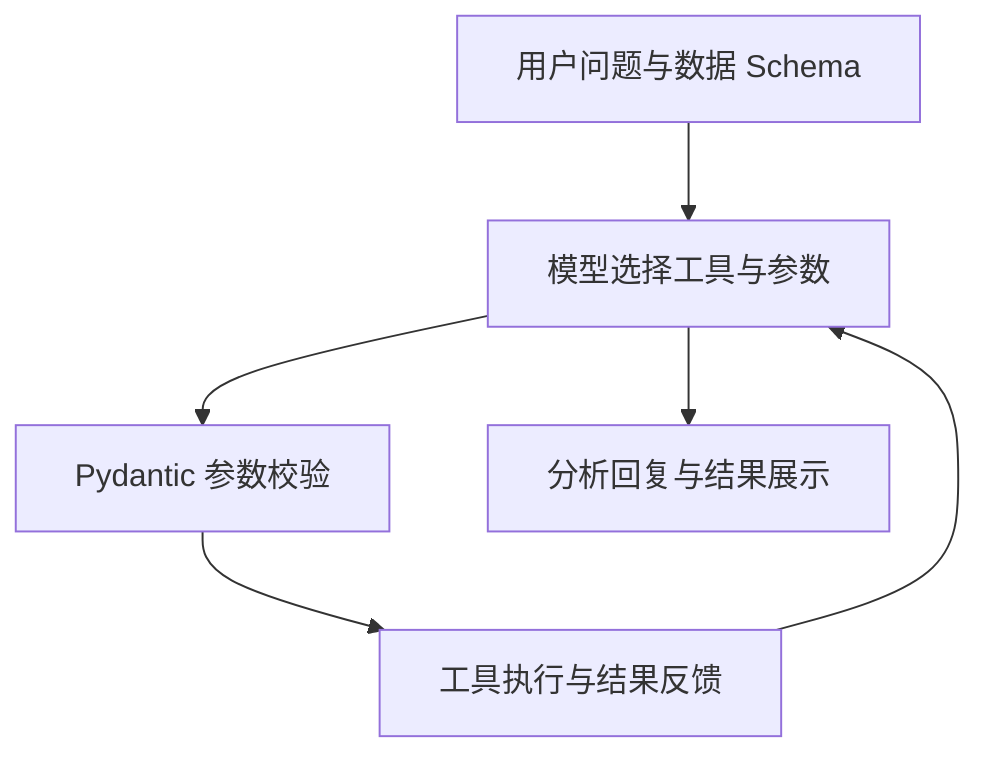

# Data Analysis Agent

基于 Python、DeepSeek API 与 Function Calling 的数据分析应用，支持通过自然语言完成结构化数据探索、统计汇总、趋势分析、可视化与数据清洗。

项目采用单 Agent 工具调用架构：模型负责理解问题、选择工具并生成分析说明，Pandas 与 SQLite 负责执行计算，Streamlit 负责交互和结果展示。用户可上传数据，也可使用内置的模拟销售数据体验分析流程。

[在线演示](https://data-analysis-agent-h.streamlit.app) · [技术设计](docs/DESIGN.md) · [评测说明](docs/EVAL.md)

## 主要功能

| 功能 | 实现范围 |
| --- | --- |
| 数据读取与探索 | 支持 CSV、TSV、XLSX，查看字段类型、缺失值、描述性统计、频数及相关性 |
| 分组与多维汇总 | 支持最多 3 个分组字段、6 个指标，以及整体汇总和 Top N；区分行数、非缺失数、去重数与数量求和 |
| 条件筛选 | 支持最多 8 个条件的单层 AND / OR 组合，以及显式日期解析 |
| 趋势与可视化 | 按日、周、月、季度汇总；支持柱状图、折线图、直方图、散点图和箱线图 |
| 只读 SQL | 对固定工具难以表达的查询，使用内存 SQLite 执行单条 SELECT，支持窗口函数、CASE WHEN 与子查询 |
| 数据清洗 | 支持删除重复行、删除缺失行、中位数或众数填充；对话清洗先预览，再由用户确认应用 |
| 结果导出与追踪 | 下载结果表、清洗后的数据和图表，查看工具参数、执行结果、耗时及 Token 用量 |

除自然语言对话外，应用提供离线分析、多维汇总与手工清洗页面，无需配置 API 即可使用。销售场景下可加载业务口径提示，辅助区分订单数量、订单编号与数据行数。

## 实现方式

### 工具调用流程

项目封装了 10 个工具，涵盖数据概况、缺失值统计、频数统计、分组聚合、相关性分析、绘图、清洗预览、时间趋势、多维汇总与 SQL 查询。模型根据当前数据 Schema 生成工具调用，参数经 Pydantic 校验后执行，结果回传模型用于后续分析或生成回复。



常见统计任务优先使用预定义工具，复杂查询通过只读 SQL 补充。单次请求最多进行 5 轮模型调用、10 次工具调用；历史对话按字符预算保留。工具执行失败时，错误信息回传模型，连续失败后追加纠错提示。

### 数据修改与执行约束

- **参数校验**：工具参数由 Pydantic 定义，限制字段、类型、枚举值及关联条件，拒绝未知工具和非法参数。
- **清洗确认**：模型只能生成清洗预览。用户确认前复核数据版本与预览统计，防止在已变更的数据上应用旧提案。
- **只读查询**：SQL 在内存数据库中执行，启用只读模式，并限制语句类型、返回行数及执行指令预算。
- **执行范围**：未开放任意 Python 代码执行接口；分析计算由预定义函数和受限 SQL 完成。

### 运行记录

每轮对话记录模型请求次数、工具参数与结果、执行耗时、Token 用量和按配置单价估算的成本，支持下载 JSON 供复核。Token 用量缺失或仅部分返回时会标明状态，估算成本不作为实际账单。

项目还提供参考 Langfuse / OpenTelemetry 结构的追踪导出，当前未集成对应 SDK 或自动上报服务。

## 快速开始

项目已在 Python 3.14 环境下运行。依赖列表见 [requirements.txt](requirements.txt)。

### 1. 获取代码并安装依赖

```bash
git clone https://github.com/ShiqiHuang-02/data-analysis-agent.git
cd data-analysis-agent

python3 -m venv .venv
source .venv/bin/activate
python -m pip install -r requirements.txt
```

Windows PowerShell 用户使用 `.venv\Scripts\Activate.ps1` 激活虚拟环境。

### 2. 配置模型服务

复制配置模板：

```bash
cp .env.example .env
```

在 `.env` 中填写 `DEEPSEEK_API_KEY`，并根据所用服务配置 `DEEPSEEK_MODEL` 与 `DEEPSEEK_BASE_URL`。API Key 可在 [DeepSeek 开放平台](https://platform.deepseek.com/) 获取。包含真实密钥的 `.env` 文件不应提交至仓库。

### 3. 启动应用

```bash
python -m streamlit run app_streamlit.py
```

打开终端提示的地址，默认是 [http://localhost:8501](http://localhost:8501)。未配置 API Key 时，仍可使用离线分析和手工清洗功能。

## 使用示例

以下问题适用于内置的 [sales_demo.csv](sample_data/sales_demo.csv)：

| 任务 | 自然语言示例 |
| --- | --- |
| 数据探索 | 总结这份数据的字段类型、数据量和缺失情况。 |
| 多维汇总 | 按地区和渠道统计销售额总和、订单数总和与平均客户满意度，按销售额降序排列。 |
| 条件筛选 | 筛选地区为华北且销售额大于 100 的记录，按渠道汇总销售额。 |
| 时间趋势 | 按月汇总销售额，并绘制趋势图。 |
| 数据清洗 | 使用中位数填充客户满意度这一列的缺失值。 |

分析结果及工具执行记录可在对话页面查看。清洗任务需确认后才会修改当前数据，也可取消操作或恢复原始数据。

示例数据中的“订单数”是数量字段，其总和与数据行数含义不同。多维汇总结果附有指标定义、有效记录数和截断说明，便于核对统计口径。

## 测试与评测

### 自动化测试

```bash
python -m pytest -q
```

测试覆盖工具计算、组合筛选、日期边界、参数校验、清洗确认、上下文预算、错误反馈、运行统计及 Streamlit 离线交互。Agent 流程测试使用模拟客户端，不调用真实 API，也不代表真实模型的任务准确率。

### 模型评测

项目构建了 44 条自然语言任务，覆盖全部 10 个工具，以确定性工具结果作为参考答案，统计工具路由准确率、结果准确率、任务完成率、数字幻觉启发式指标、延迟与 Token 成本。

```bash
# 检查任务集与评分器，不调用 API
python -m evals.runner --mock

# 真实模型评测：先运行前 10 条，再运行全量任务
python -m evals.runner --limit 10
python -m evals.runner

# 重复评测 3 次，汇总结果
python -m evals.runner --repeat 3
```

真实评测会调用 API 并产生费用，报告默认写入 `evals/results/`，该目录已被 Git 忽略。Mock 模式直接注入参考工具调用，仅验证任务集与评分器的一致性，不能作为模型性能结果。

当前任务集基于单一模拟销售数据，尚不覆盖多轮对话和全部歧义场景；数字幻觉指标也可能误判。指标定义、评分规则与局限详见 [评测说明](docs/EVAL.md)。

单独检查 API 连通性与 Function Calling 可运行 `python scripts/check_deepseek.py`，该命令同样会发起真实请求。

## 项目结构

| 路径 | 职责 |
| --- | --- |
| `app_streamlit.py` | 数据上传、对话、离线分析、清洗确认与结果导出 |
| `core/agent.py` | 模型请求、工具调用循环、上下文预算与错误反馈 |
| `core/schemas.py`、`core/tools.py` | 工具参数定义、校验与执行入口 |
| `core/dataset.py`、`core/aggregation.py` | 数据读取、组合筛选与多维汇总 |
| `core/cleaning.py` | 清洗提案确认与数据版本校验 |
| `core/trends.py`、`core/visualization.py` | 时间聚合与图表生成 |
| `core/sql.py` | 内存 SQLite 只读查询 |
| `core/profiles.py`、`core/observability.py` | 业务口径提示、用量统计与追踪导出 |
| `tests/`、`evals/` | 自动化测试、自然语言任务集与评分器 |
| `sample_data/`、`docs/` | 模拟数据、设计说明与验收文档 |

## 适用范围与数据处理

本项目面向单用户、单数据集的交互分析场景，输入限制为 15 MB、25 万行、150 列。当前未实现多用户权限管理、数据库连接管理或生产级资源隔离。趋势分析属于描述性统计，不包含预测模型。

数据计算在应用运行环境中完成：本地启动时为本机，在线演示时为部署服务器。自然语言分析会向模型服务发送问题、选定的历史对话、数据 Schema 和工具返回结果；SQL 查询结果可能包含明细数据，频数或聚合结果也可能包含敏感信息。使用在线演示时请采用模拟或已脱敏数据。

模型可能选择错误的工具、参数或业务口径。参数校验和业务提示有助于限制执行范围，但不能替代结果核对；单层 AND / OR 筛选不支持混合嵌套逻辑，复杂条件需通过 SQL 表达。

## 项目来源与许可

本项目参考 [quguolin/llm-data-agent](https://github.com/quguolin/llm-data-agent) 的产品目标与部分架构思路，采用独立实现，并非直接 Fork 原仓库。来源说明见 [NOTICE.md](NOTICE.md)，许可条款见 [LICENSE](LICENSE)。
